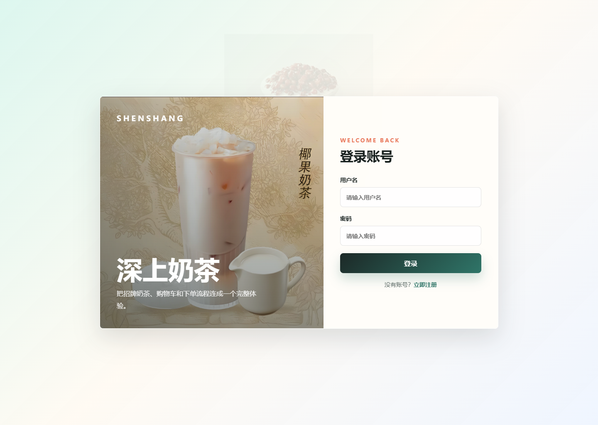
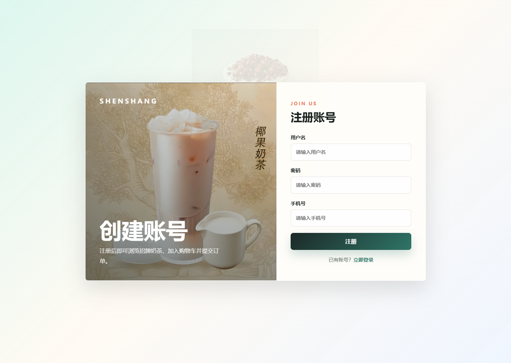
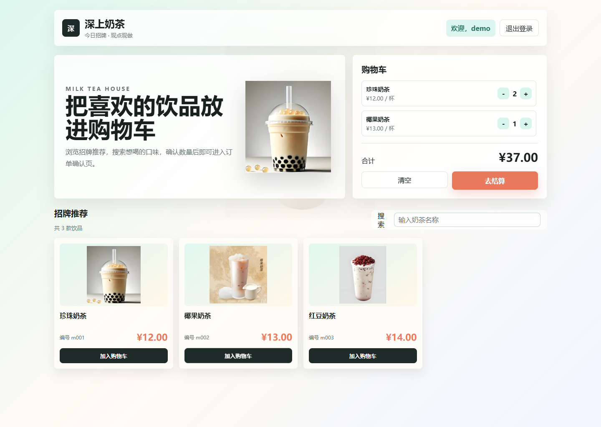
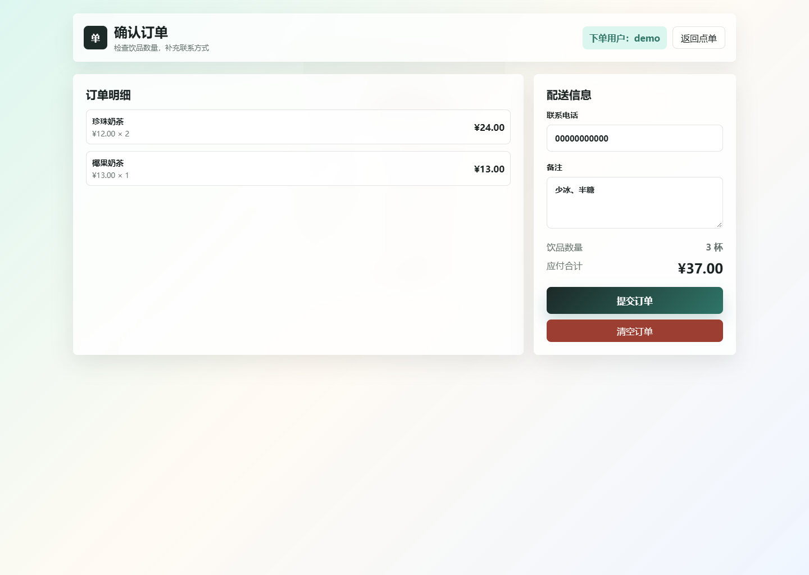

# ShoppingWeb | 深上奶茶点单系统

一个用于 Java Web 课程大作业的奶茶点单项目。前端使用 HTML、CSS、原生 JavaScript 和 Axios，后端使用 Java Servlet、JDBC 和 MySQL，围绕“注册账号、登录、浏览饮品、加入购物车、确认订单”组织页面与代码。

仓库名为 **ShoppingWeb**，页面中的品牌名为 **深上奶茶**。源码由 `MT` 后端与 `MTF` 前端组成，Java 包名为 `com.xf`。这是课程学习与本地演示项目，当前订单提交为前端交互演示。

## 页面预览

### 登录与注册





### 饮品浏览与购物车



### 订单确认



截图使用 `database/init.sql` 中的示例饮品数据展示页面，截图中的用户与订单均为演示内容。

## 功能范围

| 模块 | 已实现的行为 | 数据存放位置 |
| --- | --- | --- |
| 用户注册 | 填写用户名、密码和手机号；调用注册接口；成功后返回登录页 | MySQL `user` 表 |
| 用户登录 | 调用后端查询用户名和密码；显示成功或失败反馈 | 后端查询 MySQL；前端保存用户名 |
| 饮品列表 | 从后端获取饮品编号、名称、价格与图片，渲染商品卡片 | MySQL `milktea` 表 |
| 名称搜索 | 对已加载的饮品按名称进行即时筛选 | 浏览器内存 |
| 购物车 | 加入饮品、增加或减少数量、移除数量为零的项、计算合计、清空 | 浏览器 `localStorage` |
| 订单确认 | 展示明细、总杯数和金额；填写联系电话与备注；提交后提示并清空购物车 | 前端演示，没有订单入库 |
| 退出登录 | 清除用户名与购物车，返回登录页面 | 浏览器 `localStorage` |
| 用户删除接口 | 按手机号删除用户，返回受影响行数 | MySQL `user` 表；页面未提供操作入口 |

页面包含空购物车、搜索无结果、饮品加载失败、表单未填写等反馈。CSS 使用 Grid 和媒体查询，在窄屏下调整登录布局、商品列数和订单布局。

## 技术栈

| 层次 | 技术及用途 |
| --- | --- |
| 页面 | HTML5、CSS3、原生 JavaScript |
| 请求 | 本地 `axios.js`，使用 GET 请求与查询参数 |
| Web 服务 | Jakarta Servlet；`@WebServlet` 注解注册接口 |
| 数据访问 | JDBC、`PreparedStatement` 参数化查询 |
| 数据库 | MySQL 8.x，MySQL Connector/J 8.4.0 |
| JSON | Fastjson2 2.0.62，序列化饮品列表 |
| Servlet 容器 | 推荐 Tomcat 11；仓库自带 Servlet API 6.1 编译依赖 |
| 开发环境 | JDK 17 或更新版本、IntelliJ IDEA |

项目未使用 Spring Boot、Maven、Gradle 或前端打包工具。后端依赖 JAR 已放在 `WEB-INF/lib` 中。

## 目录结构

```text
ShoppingWeb/
├── MT/                                  # Java Web 后端
│   ├── MT.iml                           # IDEA 模块与编译输出配置
│   └── src/main/
│       ├── java/com/xf/
│       │   ├── entity/                  # User、MilkTea 数据对象
│       │   ├── dao/                     # UserDao、MilkTeaDao 数据访问
│       │   ├── servlet/                 # UserServlet、MilkTeaServlet
│       │   └── util/DBUtil.java         # JDBC 连接和外部配置读取
│       ├── resources/
│       │   └── db.properties.example    # 数据库配置模板
│       └── webapp/WEB-INF/
│           └── lib/                     # JDBC、JSON、Servlet 编译依赖
├── MTF/                                 # 独立静态前端
│   ├── login.html                       # 登录
│   ├── regist.html                      # 注册，文件名保留 regist
│   ├── main.html                        # 饮品列表、搜索、购物车
│   ├── order.html                       # 订单确认
│   ├── style.css                        # 公共样式与响应式规则
│   ├── axios.js                         # HTTP 请求库
│   └── image/                           # 珍珠、椰果、红豆奶茶图片
├── database/init.sql                    # 与 DAO 对应的演示建表和商品数据
├── docs/images/                         # 页面预览截图
├── .gitignore                           # 排除密码、编译文件与个人 IDE 状态
└── README.md
```

## 请求流程

```text
登录 / 注册页面
    → Axios GET /user?op=...
    → UserServlet
    → UserDao → DBUtil → MySQL

饮品页面
    → Axios GET /milkTea?op=getAll
    → MilkTeaServlet
    → MilkTeaDao → MySQL
    → JSON 数组 → 页面卡片

加入购物车 → localStorage → 订单确认页 → 前端提交提示
```

Servlet 通过 `op` 参数分发操作。饮品接口返回 JSON 数组，用户接口返回布尔值或数据库受影响行数。当前响应使用 UTF-8，并设置 `Access-Control-Allow-Origin: *`。

## 本地运行

### 1. 克隆仓库

```bash
git clone https://github.com/fplity/ShoppingWeb.git
cd ShoppingWeb
```

### 2. 准备数据库

启动本地 MySQL，通过命令行或数据库客户端执行 `database/init.sql`：

```sql
SOURCE /你的项目路径/ShoppingWeb/database/init.sql;
```

脚本根据当前 DAO 的字段与插入顺序补充演示结构，创建 `mt` 数据库、`user` 与 `milktea` 表，并加入三款示例饮品。脚本不包含真实用户或数据库账号密码，也不执行删库、删表操作。已有同名表时，请先核对表结构是否兼容。

### 3. 设置数据库连接

将 `MT/src/main/resources/db.properties.example` 复制为同目录下的 `db.properties`，填写本机连接信息：

```properties
db.url=jdbc:mysql://localhost:3306/mt
db.username=YOUR_DATABASE_USER
db.password=YOUR_LOCAL_DATABASE_PASSWORD
```

`db.properties` 已加入 `.gitignore`。编译时应将它作为资源复制到运行时 classpath 中，例如 `WEB-INF/classes/db.properties`。

也可使用 Tomcat 运行配置中的环境变量 `DB_URL`、`DB_USERNAME`、`DB_PASSWORD`，或 JVM 参数 `-Ddb.url=...`、`-Ddb.username=...`、`-Ddb.password=...`。配置优先级为 **JVM 参数 > 环境变量 > 本地配置文件**。未设置地址和用户名时，默认连接本机 `mt` 数据库，用户名为 `root`；密码必须显式配置。

### 4. 配置与启动后端

在 IntelliJ IDEA 中打开 `MT` 目录，选择 JDK 17 或更新版本，将 `src/main/java` 标记为源码目录、`src/main/resources` 标记为资源目录，并把 `src/main/webapp/WEB-INF/lib` 加为模块依赖。

添加 Tomcat 11 本地运行配置，将 `MT/src/main/webapp` 配为 Web 部署目录，Java 类输出到 `WEB-INF/classes`。使用 **8080** 端口，将 Application context 设为 **`/webapp`**，与前端现有地址一致。Servlet 由注解映射，不需要额外的 `web.xml`。

不使用 IDEA 编译时，可在仓库根目录的 PowerShell 中执行：

```powershell
$classes = 'MT/src/main/webapp/WEB-INF/classes'
New-Item -ItemType Directory -Force -Path $classes | Out-Null
$sources = Get-ChildItem 'MT/src/main/java' -Recurse -Filter *.java
javac --release 17 -encoding UTF-8 -cp 'MT/src/main/webapp/WEB-INF/lib/*' -d $classes $sources.FullName
Copy-Item 'MT/src/main/resources/db.properties' "$classes/db.properties"
```

启动 Tomcat 后可访问饮品接口进行检查：

```text
http://127.0.0.1:8080/webapp/milkTea?op=getAll
```

### 5. 打开前端

用 IDEA 的浏览器预览功能打开 `MTF/login.html`，或用静态 HTTP 服务托管 `MTF`。例如，本机已安装 Python 时可执行：

```bash
python -m http.server 5500 --directory MTF
```

然后访问 `http://127.0.0.1:5500/login.html`。前端页面地址与后端接口地址是两个服务，静态页面服务并不负责启动 Java 后端。

首次使用请在注册页创建自己的账号，再登录并浏览饮品。前端使用 `localStorage` 保存当前用户名与购物车，退出登录会清除两者。

## 接口说明

当前前端固定使用基础地址 `http://127.0.0.1:8080/webapp`，所有已实现操作均为 GET 请求。

| 接口 | `op` | 其他参数 | 返回内容 |
| --- | --- | --- | --- |
| `/user` | `login` | `username`、`password` | `true` 或 `false` |
| `/user` | `register` | `username`、`password`、`tel` | 新增行数，成功通常为 `1` |
| `/user` | `delete` | `tel` | 删除行数 |
| `/milkTea` | `getAll` | 无 | 饮品 JSON 数组 |

饮品数组的每项包含以下字段，图片文件名相对于 `MTF/image/`：

```json
{
  "mid": "m001",
  "mname": "珍珠奶茶",
  "price": 12.0,
  "image": "zz.png"
}
```

搜索、数量调整、结算和订单提交提示均在浏览器中执行，当前没有对应后端接口。

## 数据结构

| 表 | 字段 | 用途 |
| --- | --- | --- |
| `user` | `username`、`password`、`tel` | 账号查询、注册、按手机号删除 |
| `milktea` | `mid`、`mname`、`price`、`image` | 饮品列表与图片展示 |

`UserDao.register()` 使用三列顺序插入，建表时需保持 `username`、`password`、`tel` 的顺序。数据库初始化文件已按此顺序定义。

## 当前实现与后续方向

当前版本适合演示 Java Web 分层结构、Axios 请求、JDBC 数据访问和浏览器购物车。订单提交只显示成功提示，并清空本地购物车，不代表已生成后台订单或完成付款。

登录状态目前由前端用户名标记控制，后端未实现 Session、Token 或接口权限校验。账号密码仍按原课程逻辑明文存储，并通过 GET 参数提交；部署真实服务前需要改为 POST、密码哈希、服务端鉴权和 HTTPS。后续还可以补充订单持久化、库存管理、统一错误响应与 JDBC 资源关闭。

## 常见问题

| 现象 | 检查方法 |
| --- | --- |
| 登录或饮品加载提示服务未启动 | 确认 Tomcat 正在运行，并检查 8080 端口及 `/webapp` 上下文 |
| 数据库连接失败 | 检查 MySQL 服务、`mt` 数据库、账号授权与本地配置是否进入运行 classpath |
| 图片无法显示 | 检查数据库 `image` 字段是否为 `zz.png`、`yg.png`、`hd.png` 等实际文件名 |
| Servlet 类加载失败 | 使用 Jakarta Servlet 兼容的 Tomcat 11，不要直接用基于 `javax.servlet` 的 Tomcat 9 |
| 双击 HTML 后页面请求异常 | 通过 IDEA 预览或静态 HTTP 服务打开前端，并单独启动 Java 后端 |

## 仓库内容说明

仓库包含 Java 源码、前端页面、饮品图片、现有依赖 JAR、演示建库脚本与运行说明。真实数据库配置、编译后的 `.class` 文件、IDE 个人工作状态和临时验证文件不会上传。`database/init.sql` 是配套演示脚本，不是本机数据库备份。
